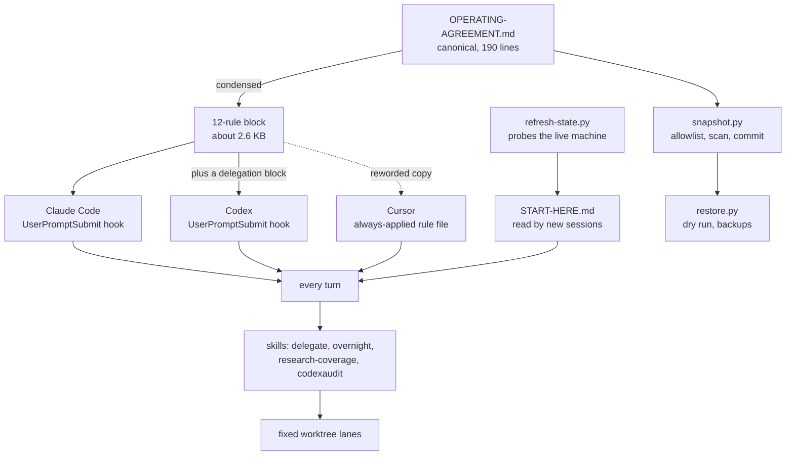

# AI Development Workflow

An operating setup for coding agents that runs across Claude Code, Codex and Cursor. One written agreement defines how the agents work. Small scripts add its rules to every prompt and regenerate the facts that a new session starts from. The setup is versioned, and a scanner stops a credential from reaching the history.

| Contents | |
|---|---|
| Canonical agreement | 190 lines of Markdown |
| Hooks (scripts the agent tool runs at fixed events, such as prompt submission) | 4 for Claude Code, 3 for Codex, an always-applied rule file for Cursor |
| Skills (instruction files an agent loads on demand) | 10 |
| Versioning | allowlisted snapshot with a six-pattern credential scanner, and a restore that defaults to a dry run |
| Dependencies | Python standard library |

Designed by Zachary Adams from 05/2026. Skills and scripts were drafted with Claude and Codex and revised as failures showed up.

## Structure



Injecting rules, probing state, scanning for credentials and refusing a bad route must behave identically every time, so they are code. The skills are written instructions for work that needs judgment.

## Rules on every turn

Instructions given once at the start of a session fade as the context grows and is summarised. The [`preference_enforcer`](hooks/claude-code/preference_enforcer.py) hook adds the 12 rules again on every prompt. The block is a short form of the agreement, about 2.6 KB. [`task_ledger_reminder.py`](hooks/claude-code/task_ledger_reminder.py) reminds the agent to list every request, with more detail when the message looks like it holds several.

## A hook that held every session for two minutes

The file index hook scanned the disk synchronously when a session started, and the scan took 131 seconds. [`file_indexer.py`](hooks/claude-code/file_indexer.py) now returns at once. It checks the index age, takes a lock that expires after 15 minutes, and starts a detached rebuild only when the index is stale.

## Memory that a new session can rebuild from

Tools and accounts change, and each tool's own memory disappears with them. The source of truth is Markdown on disk. [`refresh-state.py`](state/refresh-state.py) regenerates the factual half of the starting document: tools, skills, MCP servers, each repository's git state and the open work items. Every probe is guarded on its own, so one missing folder cannot blank the document.

`refresh-state.py` also runs the hooks. A hook that throws stops adding rules without any visible error, so the probe feeds four of them a sample prompt and reports `MISSING` or `FAILING` unless each one is present, exits cleanly and prints real output.

## Versioning without leaking credentials

The files worth versioning sit in the same home directories as keys and tokens. [`snapshot.py`](versioning/snapshot.py) handles that in three layers:

| Layer | Behaviour |
|---|---|
| Allowlist | Copies only the files and trees named in `MANIFEST`, and filters the trees by extension |
| Forbidden paths | Refuses any path that touches a secrets folder or an auth file, even when the allowlist reaches it |
| Scanner | Searches the copy for six credential patterns and returns before `git add` when one matches |

[`restore.py`](versioning/restore.py) goes the other way. It prints a plan by default, and with `--apply` it backs up every file it would overwrite.

## Delegation

[`offload.py`](skills/offload/offload.py) hands a fully specified task to another agent CLI. Caller, target, mode, model, effort and an absolute folder are all required. It rejects a route it cannot honour instead of approximating one: a tool calling itself, a relative folder, a write-enabled sandbox for a read-only task, or a CLI whose reasoning-effort setting cannot be verified.

Parallel work runs in at most five fixed worktrees per project, `lane-a` to `lane-e`, which are reused. The rules forbid a worktree folder per task or per date.

## Skills

| Skill | Purpose |
|---|---|
| [`delegate`](skills/delegate/SKILL.md) | Turns a message into a ledger of obligations and a dependency graph, then routes lanes |
| [`overnight`](skills/overnight/SKILL.md) | Plans unattended work, asks every question first, loops until each item is closed |
| [`autonomy`](skills/autonomy/SKILL.md) | Plans and runs work for a bounded period while the user is away |
| [`build-sprint`](skills/build-sprint/SKILL.md) | Finishes a named request and the open board items in critical-path order, alone or inside `autonomy` |
| [`research-coverage`](skills/research-coverage/SKILL.md) | Runs research with a ledger of sources searched, excluded and missing |
| [`codexaudit`](skills/codexaudit/SKILL.md) | Uses the running app as a sceptical user, files defects, repairs, repeats |
| [`handoff`](skills/handoff/SKILL.md) | Moves a session between tools without losing open items |
| [`offload`](skills/offload/SKILL.md) | Sets when to use the runner above and what to verify after it |
| [`memprompt`](skills/memprompt/SKILL.md) | Builds prompts for design tools from recorded decisions |
| [`premium-frontend-ui`](skills/premium-frontend-ui/SKILL.md) | Guides interface work; its quality taxonomy is adapted from an MIT-licensed skill credited in the file |

## External tool servers

Model Context Protocol (MCP) servers give an agent callable tools. Six are configured:

| Server | Use |
|---|---|
| codegraph | Symbol graph of the codebase: callers, callees, impact |
| tradingview | Drives a live chart for indicator development |
| mermaid | Diagrams |
| magic | Interface components |
| claude-design | Design system sync |
| Autodesk_Fusion | CAD |

None of their code is in this repository.

## Local setup

```bash
python -m unittest discover -s tests -v    # 18 tests, offline
```

The tests were written for this public copy. They check that each of the six credential patterns fires and stops a snapshot before git is called, that forbidden paths are refused, that a restore is a dry run by default, that the runner rejects routes it cannot honour, and that the hooks emit all 12 rules. [`examples/claude-code-settings.json`](examples/claude-code-settings.json) shows how the hooks are registered.

[`PROVENANCE.md`](PROVENANCE.md) lists the source revision and what changed for the public copy.
